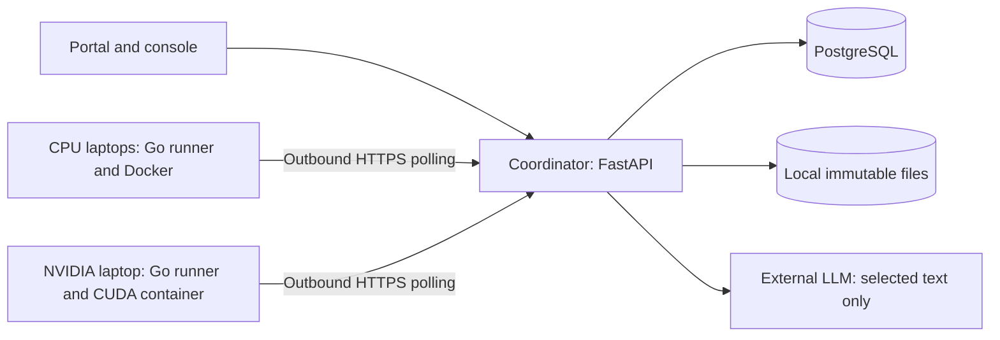

# Device inventory

Status: awaiting physical-device measurements from the runner owner. No hardware has been inventoried in this branch. The plan targets five laptops including the coordinator, with one NVIDIA/CUDA device; this is a target, not a verified inventory.

| Registered node ID | Owner consent | OS/arch | CPU / available RAM | GPU / verified CUDA / VRAM | Roles | Offered budget | Preflight revision | Reachability / date |
|---|---|---|---|---|---|---|---|---|
| Pending actual registration | Pending | Not measured | Not measured | Not measured | compute / control / validation to confirm | Not measured | Pending | Not tested |

Include every physical device, including the coordinator and reference validator. For each benchmark, save the exact compute-node subset; control-only and validation-only devices do not contribute Pi to its denominator. Record runtime/image/model revisions, power state, 5-minute runner idle CPU/RSS, and Docker/WSL overhead separately. Do not collect serial numbers or personal files.

## Deployment diagram

Verify each device can reach the coordinator on the actual campus SSID using trusted HTTPS, upload/download, reconnect and heartbeat. If client isolation prevents routing, document an approved reachable campus host. No implicit external relay.
