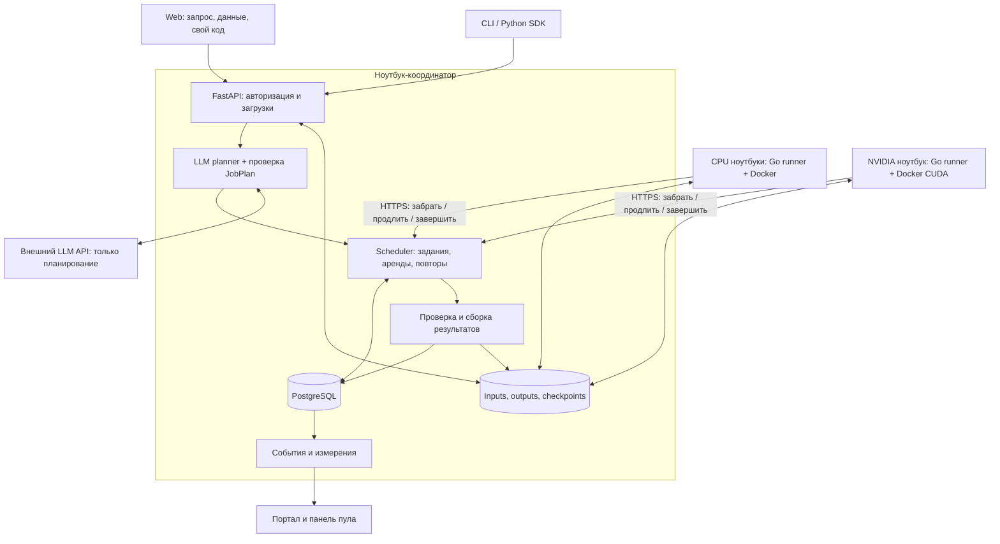

# Campus Pool Implementation Plan

> **For agentic workers:** REQUIRED SUB-SKILL: Use superpowers:subagent-driven-development (recommended) or superpowers:executing-plans to implement this plan task-by-task. Steps use checkbox (`- [ ]`) syntax for tracking.

**Goal:** Построить удобный кампусный сервис: подключить личный ноутбук, описать задачу или загрузить свой код, получить проверяемый результат на общем пуле CPU/GPU и показать измеренный эффект объединения устройств.

**Architecture:** Один CPU-ноутбук координирует работу и хранит состояние; остальные устройства исходящими HTTPS-запросами забирают подходящие задания. Центральный LLM превращает запрос и выбранный проект в проверяемый JobPlan; диспетчер и восстановление работают независимо от LLM. На участнике запускается временный небольшой Go-клиент и контейнерный runtime, без постоянно работающей локальной модели.

**Tech Stack:** React + TypeScript + Vite + Tailwind/shadcn; Python + FastAPI + Pydantic + SQLAlchemy/Alembic; PostgreSQL; локальное файловое хранилище; Go CLI/runner; Docker/Compose; PyTorch/Transformers; внешний LLM API со структурированным выводом.

**Spec:** [Сисдиз, включая матрицу отказов](../specs/2026-11-14-campus-pool-design.md). [Официальный бриф, 5 страниц](../../briefs/D_Campus_Edge_Fabric_EN.pdf). При различиях этот план уточняет интерфейсы, распределение работы и конкретные демонстрационные нагрузки, сохраняя ограничения сисдиза.

**Статус:** план реализации, не готовая система. На момент подготовки в репозитории нет перечисленных ниже компонентов; пути и команды являются целями реализации. Никакие показатели производительности пока не измерены. Работают четыре владельца веток: две относительно лёгкие части и две сложные. Владельцы сложных частей могут делить их внутри команды.

## Global Constraints

- Пять физических ноутбуков, один NVIDIA/CUDA; координатор тоже входит в инвентаризацию. Если он выполняет workload, ему нужен отдельный baseline и место в знаменателе эффективности.
- Минимум два физических устройства выполняют полезную работу в одном демонстрационном тесте. Единственный GPU, обучающий модель, сам по себе этого не доказывает.
- Работа через кампусный Wi-Fi требует проверенной доступности координатора. Client isolation нельзя исправить выбором другого HTTP-протокола; при блокировке нужен разрешённый доступный узел кампуса. Никакого неявного внешнего relay.
- Все вычислительные данные, контейнеры и модели обслуживаются локально. Внешний LLM получает только выбранные текстовые фрагменты проекта/схемы данных; это отдельно показывается перед отправкой. Уже подготовленные задания продолжаются при недоступности API.
- Участие только с согласия владельца; первый релиз рассчитан на доверенный пул с несекретными данными. Docker не скрывает данные от администратора вычисляющего ноутбука.
- Обычный код исполняется в sandbox на одном совместимом устройстве; распределение требует поддерживаемого адаптера. Общей VRAM, автоматического model parallelism и переноса памяти процесса нет.
- Стартовые значения: long poll 25 s, heartbeat 10 s, lease 60 s; до трёх попыток для временной ошибки; целевая длительность прогретого батча 5–20 s. Все значения конфигурируемы и проверяются на реальной сети.
- Независимые CPU/GPU очереди используют единый бюджет устройства. GPU допускается явно; нет обещания универсального жёсткого процента GPU/VRAM.
- Повторное вычисление возможно; результат и кредиты принимаются один раз. Нельзя выдавать это за exactly-once execution.
- Исходники, секреты и пути из пользовательского проекта не становятся инструкциями для сервера или LLM. Координатор не исполняет присланный код вне sandbox.
- English UI для демонстрации, Unicode в запросах, путях и данных; текстовые примеры EN/ZH. Все ассеты UI локальные.
- Версии зависимостей, образов и моделей фиксируются в foundation-коммите после проверки доступной среды; нельзя использовать плавающий `latest` в воспроизводимом демо.

## Review Focus

1. Путь проекта с пробелами/кириллицей, `.env`, symlink наружу и ZIP traversal: безопасная упаковка и отказ опасной распаковке. Тесты части 4 и части 3.
2. Потерянный ответ после успешного commit и поздний результат просроченной попытки: один результат, одна запись ledger. Тесты части 3.
3. Ноутбук уснул, часы изменились или runner умер, а Docker работает: аренда по времени сервера, ограничение жизни контейнера, отсутствие двойного принятия. Части 3–4.
4. LLM вернул валидный JSON, но выдумал CUDA, checkpoint или чтение локального пути: семантический отказ до выполнения. Часть 3; понятное объяснение в части 1.
5. Судья изменил вход/concurrency, а единственный GPU исчез: новый честный benchmark и `waiting_for_capacity`, без старых ответов или скрытой CPU-подмены. Части 2–4.

## Продукт и демонстрация

Позиционирование: **«Опиши вычислительную задачу или принеси свой код — используй свободные устройства своей команды»**. Начальные пользователи: лаборатории, курсы ML и исследовательские команды. Они получают приватный пул, понятный запуск и результаты; участник управляет своим вкладом и может выйти.

Три уровня одного сервиса:

| Уровень | Действие пользователя | Что делает система |
|---|---|---|
| Простой | Описывает задачу, выбирает рецепт, прикладывает данные | LLM задаёт необходимый вопрос и готовит план из поддерживаемых операций |
| Свой код | Загружает проект или запускает `campus run --gpu -- python train.py` | Выбирает совместимое окружение, готовит inputs/outputs, запускает код и возвращает файлы |
| Продвинутый | Выбирает подготовленный OCI-образ и адаптер | Использует тот же JobPlan и протокол выполнения; образ предварительно разрешён в пуле |

**Сценарий A, обязательный для доказательства пула:** поиск по набору текстовых документов. Вход JSONL/TXT, затем разбиение текста, вычисление embeddings на нескольких ноутбуках, сборка индекса и поиск с отрывками/источниками. Начальная модель `intfloat/multilingual-e5-small`: фиксировать revision, tokenizer, pooling и precision; учитывать `query:`/`passage:` и предел длины. Это выбор модели, а не обещание скорости. Единица работы — принятый текстовый фрагмент с фиксированной политикой разбиения; не считать повторные попытки. Смысл нагрузки — полезный поисковый индекс, а не повтор одного текста для загрузки GPU.

**Сценарий B, обязательный для проверки своего кода:** небольшой PyTorch-классификатор изображений на NVIDIA-ноутбуке. Пользователь передаёт размеченный dataset, train.py/requirements или использует рецепт. Выход: веса, конфигурация, train/validation метрики и пример inference. Рецепт сохраняет полный checkpoint; остановка и возвращение GPU продолжают обучение с последнего опубликованного checkpoint. Обычный сторонний скрипт без поддержки resume честно получает только перезапуск с начала. Эти два сценария используют общие планирование, очередь, хранение, наблюдаемость и CLI.

LLM — обязательный интерфейс подготовки, а не диспетчер каждого батча. Планировщик предлагает, детерминированные правила разрешают исполнение, обычный scheduler выбирает устройства. Внешний AI не выполняет за ноутбуки оцениваемую нагрузку.

## Разделение репозитория и общий контракт

| Часть | Сложность / ветка | Единственный владелец путей |
|---|---|---|
| 1. Пользовательский портал | Лёгкая — `codex/portal` | `apps/portal/**` |
| 2. Панель пула, отчёт, демонстрация | Лёгкая — `codex/console` | `apps/console/**`, `tools/benchmark/**`, `docs/submission/**` |
| 3. Сервер, LLM и надёжность | Самая сложная — `codex/control-plane` | `server/**`, `contracts/**`, `infra/**`, `.github/**`, корневые конфиги и README |
| 4. Runner, CLI и реальные вычисления | Самая сложная — `codex/runner-cli` | `runner/**`, `bootstrap/**`, `environments/**`, `workloads/**`, `sdk/python/**` |

Foundation — первый результат **части 3**, не пятая задача. Владелец 3 публикует скелет и контракты, согласовав протокол runner с владельцем 4; все четыре ветки стартуют от этого коммита. Два React-приложения имеют свои `package.json`/lockfile/router и отдельные сборки. Владелец 3 соединяет их на одном origin: `/`, `/admin/`, `/api/v1/`. Владелец 3 поддерживает генератор `contracts/generate.py`; каждый участник запускает его для своего target. Generated DTO в каталогах приложений/runner — игнорируемые Git build artifacts, создаются до build/test, руками не редактируются. Это исключает конкурирующие коммиты общих типов.

### Контракты v1, которые фиксируются до параллельной разработки

- `contracts/openapi-v1.yaml`: HTTP-методы, DTO, ошибки; `contracts/schemas/{job-plan,assignment,capabilities,events}.schema.json`; `contracts/fixtures/**`: ready/offline/retrying/failed/needs_input/partial/empty состояния; `contracts/mock_server.py`: воспроизводимый fixture API для обоих UI.
- JSON — `snake_case`; IDs — UUID; время — UTC RFC3339; объёмы — bytes; длительности — ms; digest — SHA-256. Enum и units одинаковы в Go/Python/TS. Версия API и диапазон совместимости проверяются до join.
- Ошибка: `{code, message, field_errors, retryable, request_id}`. Коды минимум: `LEASE_EXPIRED`, `STALE_ATTEMPT`, `SESSION_REPLACED`, `FORBIDDEN`, `IDEMPOTENCY_CONFLICT`, `CAPACITY_UNAVAILABLE`, `ARTIFACT_NOT_READY`, `QUOTA_EXCEEDED`, `UNSUPPORTED_ENVIRONMENT`, `PLANNER_UNAVAILABLE`.
- Событие: `{event_id, occurred_at, entity_type, entity_id, type, payload}`. Cursor/`Last-Event-ID`, ограниченное воспроизведение; при слишком старом cursor — явный reset и получение свежего snapshot.
- Task: `queued / leased / running / verifying / retry_wait / waiting_for_capacity / succeeded / failed / cancelled`. Node: `preflight / ready / draining / paused / offline / quarantined`. Preview: `inspecting / planning / needs_input / validating / ready / failed / cancelled`. Job агрегирует task states, отдельно сообщает `accepted_units`, `failed_units` и `total_units`; частичный результат не называется полным успехом.
- `JobPlan`: `schema_version, plan_revision, project_digest, input_manifest_digest, execution_kind(single|map|dag), stages[], job_deadline_at, retry_policy, assumptions[], questions[], evidence[]`. Stage: `stage_id, depends_on[], adapter{id,version}, variants[], argv[], working_dir, bindings[], outputs[], network_policy, task_deadline_ms, validation_policy, resume_policy`. Variant: `variant_id, image_digest, platform, accelerator(cpu|cuda), resource_requirements`. Для `single` одна stage; `map` разбивает её вход через адаптер; `dag` имеет явные зависимости. Владелец/пул/права назначаются сервером. `resume_policy` различает `checkpoint / restart / unsupported`; parallelism требует зарегистрированного адаптера, а не уверенности LLM.
- `Capabilities`: `os, arch, cpu_logical, memory_available_bytes, disk_available_bytes, runtime{type,version,healthy}, gpus[{id,vendor,vram_bytes,driver,cuda_verified}], power_state, offered_budget, preflight_revision`. Не собирать личные файлы или серийные номера железа.
- `Assignment`: `job_id, stage_id, task_id, attempt_id, generation, variant_id, lease_token, lease_expires_at, lease_remaining_ms, heartbeat_interval_ms, task_deadline_at, manifest_digest, adapter{id,version}, image_digest, platform, argv[], working_dir, inputs[], outputs[], resource_limits, network_policy, resume_checkpoint, validator_policy`. Диспетчер выбирает один из разрешённых variants. Все mutation-запросы попытки несут attempt/generation/token и session identity.
- `SearchRequest`: `query, top_k, index_artifact_id`; `SearchResult`: `matches[{item_id, source, excerpt, score}], model_digest, index_digest`. Индекс должен принадлежать принятому job и быть доступен пользователю; query берёт тот же tokenizer/model/preprocessing профиль, что и индекс.
- `StandaloneRecord` и `BenchmarkReport` фиксируются отдельными JSON Schema в foundation. Сравнение требует совпадения workload/quality/input distribution/resource settings; local timings подписаны credential зарегистрированного узла, но подпись доказывает происхождение, а не честность измерений.

| Группа API `/api/v1` | Контракт |
|---|---|
| Подключение | `GET /protocol`, `/health`; `POST /invitations`, `/invitations/redeem`, `/node-sessions`; `PUT /node-sessions/{id}/capabilities`; `DELETE /credentials/{id}` |
| Пользовательская сессия | `POST /auth/login` по отдельному member invitation; `POST /auth/logout`; `GET /auth/me`; `POST /auth/cli-credentials` из авторизованной сессии; device invitation не даёт пользовательские права |
| Каталог | `GET /recipes`, `/recipes/{id}`, `/environments` |
| Планирование | `POST /job-previews` → 202 + preview_id; `GET /job-previews/{id}` и `/events`; `POST /job-previews/{id}/answers` с question_id/plan_revision; `POST /job-previews/{id}/cancel` |
| Задачи | `POST /jobs` с preview_id/plan_revision и Idempotency-Key; `GET /jobs`, `/jobs/{id}`, `/jobs/{id}/events`, `/jobs/{id}/logs` с cursor; `POST /jobs/{id}/cancel` |
| Поиск | `POST /jobs/{id}/search` по принятому индексу → 202 + search_job_id; query embedding исполняется совместимым worker, затем ранжирование зарегистрированным адаптером; без ресурса — waiting_for_capacity. Результат получается обычным GET job |
| Исполнение | `POST /work/next` → Assignment или 204; `POST /attempts/{id}/started`, `/renew`, `/complete`, `/fail`, `/release`; `GET /attempts/{id}` |
| Файлы | `POST /uploads`; `PUT /uploads/{id}/parts/{part}`; `GET /uploads/{id}`; `POST /uploads/{id}/finalize`; `GET /artifacts/{id}/content` с Range; attempt-scoped `POST /attempts/{id}/checkpoints` |
| Наблюдение | `POST /attempts/{id}/logs`, `/telemetry`; `POST /node-sessions/{id}/telemetry` для idle/system metrics; `GET /nodes`, `/nodes/{id}`, `/pool/summary`, `/pool/events`, `/credits`; `POST /nodes/{id}/control` с drain/stop/resume/quarantine/release |
| Проверки пула | `POST /benchmarks`; `POST /benchmarks/{id}/standalone-results` для локального baseline; `GET /benchmarks`, `/benchmarks/{id}`, `/benchmarks/{id}/export`; параметры workload/input/node_ids/concurrency/batch_policy/repetitions |

Подробные DTO этих маршрутов задаёт foundation, не каждый UI по-своему. Любое несовместимое изменение — сначала контракт, fixtures и согласование с соседним владельцем, затем реализация. Установочные invitations не заменяют пользовательскую авторизацию; creator/admin и node credential имеют разные scopes.

## Часть 1 — пользовательский портал, лёгкая

**Ветка:** `codex/portal`. **Результат:** незнакомый пользователь подключает устройство или запускает работу и получает файлы без объяснения внутреннего протокола.

**Файлы:** `apps/portal/src/pages/{Home,Contribute,NewJob,JobDetails}.tsx`; `src/components/{PlanPreview,UploadPicker,ResultViewer,JobTimeline}.tsx`; `src/lib/{api,events}.ts`; `src/generated/api.ts`; `tests/user-journey.spec.ts`; собственные build/lock/config.

**Interfaces:** потребляет user-facing маршруты контракта v1 и fixture API; экспортирует собранный `apps/portal/dist/`. `submitPreview(input: PreviewRequest): Promise<Preview>`; `startJob(preview_id: string, plan_revision: number, idempotency_key: string): Promise<Job>`; `subscribeJob(job_id: string, cursor?: string): AsyncIterable<PoolEvent>`. Серверные DTO генерируются владельцем 3; UI не решает admission, кредиты или сроки lease.

- [ ] Создать приложение, маршруты и API client с единым обработчиком ошибок/auth. Страница доступна с телефона и ноутбука; JS/CSS не требуют CDN.
- [ ] Сделать главный экран с двумя действиями: **Run a task** и **Contribute compute**. Подключение показывает готовую команду для ОС, реальные результаты preflight, разрешённый бюджет, GPU opt-in, Drain/Stop. Отсутствующий Docker показан с конкретным следующим действием.
- [ ] Сделать новый запуск: текст запроса, рецепт или проект ZIP/папка, явно выбранные данные, список и размер отправляемых файлов. Показать исключённые секреты и какие фрагменты уйдут LLM API. Тяжёлую загрузку вести через resumable upload контракт части 3.
- [ ] Сделать асинхронное планирование: состояние анализа, необходимый вопрос, ответ, preview «что запустим / где данные / что получишь / CPU или GPU / как восстанавливается». Показывать неизвестную длительность как неизвестную; кнопку Run включать только для актуального `ready` plan_revision.
- [ ] Сделать JobDetails: реальные этапы, принятые элементы, логи с явной truncation, очередь/ожидание GPU/повтор, отмена, ошибки элементов, скачивание файлов. Перезагрузка страницы продолжает наблюдение и не создаёт новый job. Поиск по готовому индексу показывает источники; обучение показывает метрики и скачиваемую модель.
- [ ] Добавить Playwright-тесты: двойной Run сохраняет один idempotency key; stale preview требует обновления; ответы на вопрос привязаны к revision; потеря SSE восстанавливает snapshot; частичный успех не маскируется; custom-code `model.pt` доступен для скачивания. Это тесты поведения, а не точных CSS-классов.
- [ ] Проверить `npm --prefix apps/portal ci`, `npm --prefix apps/portal run build`, `npm --prefix apps/portal run test:e2e` с fixture API. Ожидается успешный build и все сценарии PASS. Затем повторить основной путь на интеграционном API и сделать коммит только своих путей.

**Готово, когда:** участник, не писавший UI, проходит подключение и запуск без подсказок; статусы и результаты подтверждены сервером; на потерю сети, нехватку GPU и ошибку планировщика есть понятный следующий шаг.

## Часть 2 — панель пула, доказательства и демо, лёгкая

**Ветка:** `codex/console`. **Результат:** красивая, проверяемая картина работы пула и готовый пакет сдачи. Задача легче серверной/runtime: она отображает и сравнивает готовые данные, а не реализует диспетчер.

**Файлы:** `apps/console/src/pages/{Overview,Nodes,Jobs,Benchmarks}.tsx`; `src/components/{Topology,ThroughputChart,AttemptTimeline,CostBreakdown}.tsx`; `src/lib/{api,events}.ts`; `src/generated/api.ts`; `tests/console.spec.ts`; `tools/benchmark/{run.py,report.py}`, `tools/benchmark/tests/test_report.py`; `docs/submission/{inventory,usage,results,product,business,demo}.md`; `docs/submission/results/` для сырых JSON/CSV.

**Interfaces:** потребляет `/nodes`, `/pool/summary`, `/pool/events`, `/credits`, `/benchmarks` и серверные `BenchmarkReport`/`CostAssumptions`; экспортирует `apps/console/dist/`, краткий HTML/Markdown-отчёт и JSON/CSV. `run.py --base-url URL --config FILE --out DIR` только вызывает API и сохраняет ответы; не изменяет БД, lease или реальные показатели.

- [ ] Сделать Overview: устройства и их роли, CPU/GPU, готовность, текущая работа, реально принятые полезные единицы, очередь и восстановление. Топология показывает реальные события; анимация не генерирует фиктивные сообщения.
- [ ] Сделать детализацию узла/задачи: история попыток, ошибка/повтор/принятие, timestamps, input/output digest, ресурсы, связь, authorised admin actions. Нулевое значение, отсутствующее измерение и оценка различаются.
- [ ] Сделать benchmark UI и HTTP driver: выбор зафиксированного workload/входа/участников/concurrency, импорт результатов `campus benchmark-local`, отдельные single-node-through-service и pool серии; новый запуск при изменении параметров. Сопоставимые серии получают один experiment_id; несовпадающие параметры нельзя молча объединить. Локальные timings имеют явное происхождение, не изображаются серверными наблюдениями.
- [ ] Сделать графики Pi/Ppool, efficiency/speedup, фиксированные интервалы CPU/GPU utilization, разбивку transfer/queue/start/compute/verify/aggregate. Показывать число повторов, медиану/разброс, cold/warm, единицы и bottleneck. Источник итоговых counters — сервер, не клиентская телеметрия.
- [ ] Сделать credits/cost view: версии тарифных единиц, accepted units, затраты LLM/хранения/дополнительной энергии/поддержки. Энергия без измерителя — оценка с предположениями. Не выводить денежные обещания или оплаченные заработки из внутренних credits.
- [ ] Подготовить product.md (одна страница): лаборатория/курс/команда, повторяющаяся задача, путь пользователя и преимущество приватного пула. business.md (не более одной страницы): первые пилоты через лаборатории/преподавателей, альтернативы, способ набора участников, стоимость и барьеры доверия/сети. Гипотеза монетизации — подписка на управление приватным пулом; маркетплейс мощности не нужен для первого релиза.
- [ ] Подготовить usage.md, results.md и demo.md по таблице сдачи ниже. Заполнить inventory фактическими данными от части 4; не придумывать оборудование, пользователей, цены или ускорение. Проверить спрос хотя бы короткими беседами с доступными реальными потенциальными пользователями, если они есть; без них честно обозначить гипотезы.
- [ ] Добавить тесты `test:report`: дубли/failed исключены, знаменатель Pi использует ровно выбранные compute nodes, нулевой/missing baseline даёт «недостаточно данных», несовместимые units не складываются, efficiency >100% сохраняется с флагом проверки. UI-тесты проверяют offline, partial, stale events и авторизацию действий.
- [ ] Проверить `npm --prefix apps/console ci`, `npm --prefix apps/console run build`, `npm --prefix apps/console run test:e2e`, `uv run --project server pytest tools/benchmark/tests -q`; ожидание — PASS. Скрипты отчёта используют стандартную библиотеку и уже согласованный pytest; новые server dependencies добавляет только владелец 3. После реального benchmark повторно построить отчёт из сохранённых сырых данных и сделать коммит своих путей.

**Готово, когда:** судья видит не только online-узлы, но и их реальные результаты, сравнение одиночной/совместной работы, ограничения и стоимость. Все семь материалов сдачи доступны из README.

## Часть 3 — сервер, LLM-планировщик и надёжность, самая сложная

**Ветка:** `codex/control-plane`. **Результат:** авторитетное состояние системы, понятное AI-планирование и корректное выполнение при сетевых повторах и отказах.

**Файлы:**

- `contracts/**` — схемы, fixtures, mock API и генерация TS/Go DTO.
- `server/campus/{main,config,auth,models,events,search}.py`; `server/migrations/**`.
- `server/campus/planner/{service,provider,inspection,validation,prompts}.py`.
- `server/campus/jobs/{service,scheduler,leases,verification,ledger}.py`.
- `server/campus/artifacts/{uploads,storage,gc}.py`; `server/campus/benchmarks/{service,metrics}.py`.
- `server/tests/{test_auth,test_planner,test_leases,test_completion,test_uploads,test_recovery,test_scheduler,test_benchmarks}.py`.
- `infra/{compose.yaml,Caddyfile,backup.ps1,restore.ps1,start.ps1,start.sh}`; `README.md`, `.env.example`, `.github/workflows/checks.yml`, `server/pyproject.toml`, `server/uv.lock`.

**Interfaces:** реализует весь API v1. `plan_job(request: PreviewRequest) -> Preview`; `claim_work(session: NodeSession, capabilities: Capabilities) -> Assignment | None`; `renew_attempt(proof: AttemptProof) -> LeaseReceipt`; `complete_attempt(proof: AttemptProof, manifest: ResultManifest) -> CompletionReceipt`; `verify_result(candidate: VerificationCandidate) -> ValidationReport`; `accept_result(candidate: VerificationCandidate, report: ValidationReport) -> AcceptanceReceipt`. HTTP handlers только валидируют/auth и вызывают эти сервисы. Адаптеры части 4 подключаются через протокол ниже, без самостоятельной записи в БД.

- [ ] **Foundation:** создать папки/контракты/fixtures/mock-server; зафиксировать enum, DTO и scopes с владельцем 4. Добавить генерацию клиентов, lockfiles, pytest с настоящим PostgreSQL и CI build двух UI/Go/Python. Первым коммитом дать всем стабильную базу ветвления.
- [ ] **Сеть и размещение:** вместе с владельцем 4 проверить каждого участника → координатор, HTTPS, upload/download и reconnect на реальном SSID. Проверить доступный LLM endpoint из этой сети. Настроить доверенный браузеру сертификат и pin для CLI, постоянные volumes, LAN binding/firewall. Если SSID блокирует сервер — документировать разрешённое другое размещение в той же доступной кампусной инфраструктуре до продолжения демо.
- [ ] **Auth:** локальные приглашения для пользователей/устройств, одноразовый join token с TTL, отзывные credentials, роли owner/admin/node. Browser — secure HttpOnly SameSite cookie + CSRF для mutation; CLI — scoped bearer. Все artifacts/logs/events проверяют доступ к job/pool. Ограничить выдачу invite, частоту requests и объём uploads. Не логировать токены/API-ключи.
- [ ] **Хранение:** migrations для users/pools/nodes/sessions/jobs/tasks/attempts/artifacts/uploads/checkpoints/events/ledger/benchmarks/previews. Atomic claim блокирует task и резервирует общий бюджет устройства. Уникальные constraints на accepted task result и начисление за него. Повторный job с тем же idempotency key/body возвращает исходный id; другой body — conflict.
- [ ] **Первый вертикальный путь:** готовый manifest → выдача одному реальному runner → upload → validator → accepted output → download. Только после этого подключать map/DAG и AI; такой порядок не делает LLM необязательным для финального продукта.
- [ ] **LLM:** серверный provider adapter с `LLM_PROVIDER`, `LLM_BASE_URL`, `LLM_MODEL`, secret key. Предпочтительный старт для кампуса в Китае — доступный команде Alibaba Model Studio/Qwen endpoint; зафиксировать конкретную модель после live capability probe. Для поддерживаемого endpoint использовать JSON Schema output, иначе JSON mode + обязательную Pydantic validation. Другие API добавляются тем же адаптером; не предполагать полную совместимость только из-за похожего URL.
- [ ] **Инспекция проекта:** читать только разрешённый snapshot и выбранные файлы/requirements/schema под лимитами. LLM tools: list/read selected files, list recipes/environments, inspect input schema, request bounded probe. Текст README/comments/documents — данные; запретить произвольный shell, свободный fetch URL и доступ к server secrets. Нет автоматического запуска setup.py/import пользовательского пакета на координаторе.
- [ ] **Компиляция плана:** LLM возвращает JobPlan с evidence на файлы и assumptions. Проверить DAG без циклов, argv как массив, mount paths, digest окружения, права, квоты, CPU/CUDA совместимость, входы/выходы, validator/resume policy. Неоднозначность превращать в один конкретный вопрос. Probe до `ready` создаётся сервером как внутренний `purpose=probe` job из минимального детерминированно проверенного плана, связанный с preview_id/revision: те же leases/sandbox, отдельный deadline/quota, без credits/benchmark; отменяется вместе с preview. Он читает выделенную копию sample без внешних побочных действий; его вывод становится evidence этой revision. В JobPlan сохранять неизменяемую revision/digest. Run повторно проверяет права и admission.
- [ ] **Сбои AI:** асинхронный 202 и сохраняемые состояния; max 2 повторных API-попытки для временных ошибок в пределах общего planning deadline; explicit timeout/429/refusal/incomplete/schema-invalid/semantic-invalid. Уже загруженные данные сохраняются для повторного планирования. Логировать redacted provider/model/prompt revision/usage/input digest, без секретов. Недоступный LLM не блокирует renew/complete/recovery и уже валидированные manifests.
- [ ] **Lease:** каждое изменяющее состояние renew/complete/checkpoint проверяет session, generation, token и непросроченный срок по времени БД в транзакции, даже если reaper ещё не запускался. Передача в `verifying` закрывает compute lease и запрещает новую выдачу task. Verification имеет свой durable claim/deadline, не зависает навечно. Late completion → STALE_ATTEMPT/LEASE_EXPIRED. Исключение для read-only replay: авторизованный повтор уже committed complete с тем же payload возвращает сохранённый receipt независимо от текущего срока lease, а с другим payload — conflict; он не изменяет результат.
- [ ] **Результаты:** publish файлов durable/atomic до ссылки из БД; в одной транзакции проверка актуальности, acceptance, событие и ledger. Финальная проверка до commit включает состояние job/cancel. Потеря ACK → runner запрашивает receipt, а не начисляет заново. Quarantine/ошибки валидатора не обвиняют автоматически исполнителя.
- [ ] **Uploads/checkpoints:** части по номеру/размеру/checksum, resume-status, quota и finalize после всех проверок; запрещены traversal/symlink escape/zip bombs. Недописанный файл не имеет ready artifact id. Checkpoint immutable, полная manifest+digest совместимости; pointer обновляется только после загрузки всех файлов и fenced commit. Orphan GC с grace period и защитой действующих references; reconciliation после restart.
- [ ] **Scheduler:** сначала совместимость/доверие/память/политики, затем fair очередь по owner и измеренная скорость/transfer/cache. Адаптивные небольшие map-батчи, меньший хвост, target 5–20 s; GPU не забирает неподдерживаемую работу. После выдачи task его item_ids неизменяемы: OOM уменьшает только внутренний microbatch, результат принимается за полный исходный набор. Новые tasks могут иметь другой размер; уже выданный task не дробится на конкурирующие дочерние. Систематическая ошибка — остановить/объяснить, не повторять бесконечно. Дедлайн включает waiting_for_capacity. DAG ждёт accepted predecessors и блокирует downstream при failure.
- [ ] **Cancel/recovery:** cancelled job прекращает выдачи и новое принятие; ранее принятые части и credits сохраняются. Drain не берёт новые задачи, Stop просит завершить текущие. Restart координатора восстанавливает из PostgreSQL, reaper обрабатывает истекшие leases, verification/uploads не теряются; во время недоступности сервера сервис недоступен, HA не обещается. Backup сохраняет согласованный DB snapshot и все referenced immutable artifacts на отдельном устройстве; retention/GC учитывает backup. Проверить restore при потере исходного диска и явно указать RPO временем последней исправной копии.
- [ ] **Наблюдение/benchmark:** события сохраняются в транзакциях; логи/телеметрия ограничены по размеру/частоте, sequenced и с признаком gaps. Long poll обновляет node last_seen даже без active attempt. Server counters считают unique accepted units. Benchmark orchestration сначала принимает standalone records по фиксированной схеме и проверяет их конфигурацию, затем запускает single-node-through-service/pool, хранит experiment config/manifest/revisions/timing/raw metrics. Сервер не выдаёт локально сообщённые timings за независимо измеренные. Поиск создаёт отдельный search job с query embedding и ранжированием; его units/time не смешиваются с построением индекса. Scheduler не замедляет GPU ради картинки; для >=2 участников нагрузка должна быть достаточной.
- [ ] **Тесты:** до реализации переходов добавить проверки для конкурирующих claim, просроченного lease до reaper, смены session, lost ACK, cancel vs completion, crash между file publish/DB commit, validator timeout, restart в verifying, incomplete checkpoint и fair queue. Planner-тесты: prompt injection в README, валидный JSON с незаконным mount, неподдерживаемая CUDA, ложный resume, изменение проекта после preview, stale answers, API timeout, отсутствие credential/секреты в audit.
- [ ] **Проверить:** `docker compose -f infra/compose.yaml up -d db`; `uv run --project server pytest server/tests -q`; `uv run --project server python contracts/check.py`. Все команды должны быть воспроизводимы из README и завершаться PASS. Проверить реальный restart/restore на отдельной тестовой БД, не стирая единственную копию данных. Коммиты разбить по контрактам, вертикальному пути, AI, отказам и интеграции.

**Готово, когда:** одинаковый сетевой запрос не создаёт двойную работу/оплату, stale attempt не может изменить итог, LLM-план имеет проверенные основания, restart не теряет принятые результаты, API и обе UI-сборки обслуживаются одним координатором.

## Часть 4 — runner, CLI, окружения и workload, самая сложная

**Ветка:** `codex/runner-cli`. **Результат:** ноутбук реально подключается, безопасно ограничивает своё участие, выполняет CPU/CUDA-задачи и возвращает результат/прогресс.

**Файлы:** `runner/cmd/campus/main.go`; `runner/internal/{client,discovery,session,worker,leaseguard,containers,packaging,artifacts,telemetry}/`; `runner/go.mod`, `runner/go.sum`, `runner/tests/`; `bootstrap/{join.ps1,join.sh}`; `environments/{profiles.json,cpu/Dockerfile,cuda/Dockerfile,guard/}`; `workloads/{adapter.py,embeddings/,training/,generic/}`; `workloads/tests/`, `workloads/pyproject.toml`, `workloads/uv.lock`; `sdk/python/campus/{client,checkpoint}.py`; `sdk/python/pyproject.toml`.

**Interfaces:** потребляет Assignment/Capabilities и worker/upload API v1. `Discover(ctx) (Capabilities, error)`; `RunAssignment(ctx, assignment) (ResultManifest, error)`; `PackageProject(root, rules) (ProjectManifest, error)`; `CollectOutputs(root, policy) (ResultManifest, error)`. В `workloads/adapter.py`: `validate_input(manifest) -> InputReport`, `split(manifest, batch_policy) -> list[TaskSpec]`, `verify(inputs, outputs, policy) -> ValidationReport`, `aggregate(accepted_outputs) -> ResultManifest`. Эти функции вызываются частью 3 только из зарегистрированных доверенных адаптеров; произвольный присланный validator не импортируется в API-процесс.

Стык адаптера с сервером — versioned JSON `AdapterRequest{operation, payload}` / `AdapterResponse{result, error}`, схема принадлежит `contracts/`. Тяжёлые операции/ML-валидация исполняются в подготовленном ограниченном runtime адаптера; API не импортирует PyTorch или пользовательский код. `workloads` имеет собственный lockfile/среду части 4, не меняет server environment. Где координатор выполняет доверенный split/aggregate/validation, это раскрывается в inventory и timings.

- [ ] **Inventory/preflight:** собрать реальные ОС/архитектуры/CPU/RAM/GPU/диск/Docker; проверить CPU контейнер и маленькое реальное CUDA-вычисление. Bootstrap скачивает/проверяет digest бинарника по доверенному соединению, не требует host Python/Go, не ставит привилегированные компоненты молча. `campus doctor` объясняет missing runtime/WSL/driver/model/network. Передать inventory части 2.
- [ ] **Простой join:** `campus join <invite>` сохраняет pool identity, endpoint и credential с ограниченным доступом. Установка получает случайный installation_id; локальная блокировка + server session запрещают удваивать ресурсы двумя клиентами. По умолчанию щадящий CPU/RAM бюджет, пауза на батарее где доступно, GPU только opt-in. `leave --drain` и `leave --stop` различаются. Без autostart и без локального LLM.
- [ ] **CLI/SDK:** `campus run --gpu -- python train.py`, `--data ./dataset:/data`, `--output model.pt`, `logs JOB`, `fetch JOB --to DIR`, `cancel JOB`. Первый run показывает анализ/plan и запрашивает только недостающие параметры. CLI/SDK используют тот же preview → Run API; получают job_id и могут отсоединиться от наблюдения. SDK: `submit(request) -> JobHandle`, `wait(job_id)`, `download(job_id, destination)`.
- [ ] **Локальный baseline:** `campus benchmark-local --manifest FILE --repetitions 3 --out FILE` выполняет тот же адаптер/runtime с подготовленными локальными inputs без scheduler и сетевой передачи. Экспортирует versioned StandaloneRecord: device_id, config/manifest/model/image/adapter digests, resource_limits, units/quality verdict, monotonic duration_ms, timestamps, cold/warm, batch/concurrency, utilization samples и overhead. Качество проверяется той же policy; измеренное время и время проверки явно разделены. Владелец устройства запускает локально; импорт через authenticated `/benchmarks/{id}/standalone-results`, без произвольного remote shell.
- [ ] **Упаковка:** snapshot только выбранного root, `.campusignore` + секреты/.env/ключи/.git/venv по умолчанию, bounded files/bytes, digest. Отклонять symlink escape, абсолютные/родительские архивные пути. Явно подключать данные вне root. Пути с пробелами/Unicode передавать через argv, без shell-конкатенации. Переносить изменённые blobs, кеш только по проверенному digest.
- [ ] **Окружения:** подготовить проверенные CPU/CUDA OCI-профили с фиксированными deps, модели/tokenizer и wheelhouse; Docker images по архитектуре/digest. Обычный поддерживаемый Python-проект не требует Dockerfile: зависимости сопоставляются с доступными профилями/офлайн wheelhouse в изолированном шаге подготовки. Несовместимые системные deps → понятная ошибка и путь к подготовленному образу. Не выполнять сетевой pip install посреди демо; не включать x86-эмуляцию без объявления.
- [ ] **Исполнение:** исходящие long poll/renew, лимиты общего бюджета. Workload обязательно non-root без повышающих capabilities, отдельный UID от supervisor; read-only root. `/inputs` и входной resume-checkpoint read-only; `/workspace`, `/outputs` и новые `/checkpoints` writable с отдельными квотами; bounded tmp. `network_policy=none` по умолчанию, также для probe и подготовки из wheelhouse; расширение сети разрешает только проверенный профиль администратора, не LLM. Без privileged, host network, Docker socket, host credentials и посторонних mounts. CPU/memory/PID/time limits; GPU concurrency + admission по памяти. Controller работает с Docker, а пользовательский контейнер не получает его API.
- [ ] **Контроль жизни:** контейнерный PID1 guard независимо ограничивает lease/runtime. Runner публикует последовательные обновления в отдельном каталоге, смонтированном в контейнер read-only; workload не может записать туда, изменить hard deadline или послать сигнал защищённому supervisor. Образы без этого контракта не допускаются. Обновление только после успешного renew, с вычетом RTT/запаса; устаревшее sequence не продлевает срок. Guard использует собственный monotonic таймер, при истечении TERM → KILL группы процессов. Всегда действует жёсткий верхний runtime deadline; restart policy отключена. После runner crash новый клиент очищает только собственные помеченные контейнеры. Сон ОС может задержать физическую остановку; fencing сервера всё равно запрещает позднее принятие.
- [ ] **Транспорт:** resumable uploads/downloads, checksum, retries с jitter, обработка 401/403 без бесконечного цикла, receipt после lost ACK. После STALE_ATTEMPT прекратить вычисление/публикацию. Логи bounded, telemetry с sequence, CPU/GPU выборки раз в 1000 ms с measurement window; метрики попытки отделены от расходов runner/runtime.
- [ ] **Результаты своего кода:** собрать `/outputs` и объявленные output paths. Для простого `torch.save(..., 'model.pt')` по умолчанию показать и забрать новые/изменённые файлы writable workspace под quota/ignore; не потерять модель только потому, что автор не знал о `/outputs`. Не включать неизменённые dataset/source и секреты. Большой результат — явный выбор/ошибка квоты, не тихая потеря.
- [ ] **Embeddings:** создать адаптер map → aggregate и локальный поиск. Параметры preprocessing/разбиения/precision фиксируются; каждая строка имеет стабильный item_id. CPU/CUDA результаты проверяются по согласованному допуску, размерности, finite values, нормировке, принадлежности исходному item_id и полному покрытию. HF custom remote code не включать автоматически. Артефакт индекса содержит данные для просмотра источников.
- [ ] **Проверяемость:** для формального benchmark создать reference на зарегистрированном доверенном устройстве для текущего manifest и сравнить каждый выданный вектор; reference используется только валидатором, не ответами сервиса. Показать время/устройство получения reference отдельно. При новых данных пересоздать reference; допуски закрепить до серии, не подгонять после mismatch. Для interactive режима показывать фактическую глубину проверки; sampled validation не называть доказательством каждого ответа. Task-specific validator тоже изолирован и ограничен по времени/ресурсам.
- [ ] **Training/custom code:** рецепт и пример train.py на реальном пользовательском dataset с явным train/validation split; параметры/seed/метрики/веса в outputs. Доверенный ограниченный evaluator отдельно загружает сохранённые веса и проверяет метрики на закреплённой validation-части; не исполняет произвольный pickle. Для стороннего кода без зарегистрированного validator показывать «выполнение завершено, файлы сохранены; качество не проверено», не включать его в correctness benchmark. Checkpoint: model, optimizer, scheduler/step/RNG и нужное состояние sampler. Сначала атомарная локальная запись/ready marker, затем upload/finalize, затем publish pointer. `CAMPUS_RESUME_FROM` содержит только совместимый полный checkpoint. Изменение code/input/env/trainer digest запрещает слепой resume. Для своего кода SDK helper помогает сохранить checkpoint, но не добавляет resume автоматически.
- [ ] **Тесты:** missing Docker/WSL/CUDA, мало RAM/VRAM, смена capabilities, двойной join, Unicode/escaping secrets, прерванный upload, потеря ACK, stop/drain, guard после runner crash и попытка workload продлить себе lease/остановить guard, OOM microbatch с неизменным набором item_ids, нет доступного GPU, повреждённый вход, output capture, resume vs interrupted checkpoint, ложные training metrics. Проверить отсутствие outbound connection внутри workload/probe. Offline smoke запускается с заблокированным интернетом после подготовки кеша; внешний LLM для нового планирования проверяется отдельно.
- [ ] **Проверить:** после генерации DTO из foundation — `go -C runner test ./...`; `uv run --project workloads pytest workloads/tests -q`; сборка CPU/CUDA образов и реальный `campus doctor` на каждом ноутбуке. Измерить idle runner 5 минут: инженерная цель <0,5% одного logical CPU и <50 MiB RSS; отдельно измерить Docker/WSL и модель. Не выдавать цель за достигнутую без данных. Передать raw metrics части 2, сделать коммиты своих путей.

**Готово, когда:** минимум два реальных устройства исполняют одну map-задачу, CUDA подтверждена вычислением, собственный проект возвращает файл модели, отключение CPU приводит к повтору только незавершённого, GPU-training восстанавливается из опубликованного checkpoint после возвращения совместимого ресурса.

## Интеграция четырёх веток

Финальный merge сохраняется. Чтобы контракты не разъехались, два раза до него собрать временный интеграционный commit/check-out из актуальных веток: после первого реального батча и после preview → own-code → output. Это проверка совместимости, а не дополнительная постоянная ветка или пятая задача. Владелец 3 собирает, остальные исправляют только свои каталоги.

- [ ] Foundation API/fixtures/schema merged: все ветки от одного commit; breaking changes сначала согласованы.
- [ ] Первая интеграция: один реальный батч между двумя физическими машинами, TLS, upload, receipt, download; UI видит реальные события.
- [ ] Вторая интеграция: реальный LLM → immutable plan → own-code run → model.pt; отдельно >=2 compute nodes в одной map-задаче и остановка CPU-worker.
- [ ] Финальный порядок merge: `codex/control-plane` → `codex/runner-cli` → `codex/portal` → `codex/console`; migrations и generated DTO обновить одной согласованной версией. Ни один владелец не заменяет чужой lockfile/конфиг случайно.
- [ ] На итоговом SHA повторить сквозные проверки и формальные измерения; записать этот SHA в report. Ранний benchmark от другой версии не выдавать за итоговый.

### Обязательная матрица отказов после merge

Все 33 строки сисдиза остаются чеклистом. Минимальный автоматизированный набор принадлежит частям 3/4; часть 2 оформляет доказательства, часть 1 показывает пользовательский результат.

| Условия | Ожидаемый итог | Владелец проверки |
|---|---|---|
| CPU disconnect, сетевой partition, late response | Незавершённый task перевыдан; старый результат отвергнут; один credit | 3 + 4 |
| Lost completion ACK, двойной Run, дубли uploads | Тот же job/receipt/artifact; без дублирования полезных единиц | 3 |
| Restart координатора/БД в running/verifying/finalize | Принятые результаты сохранены, истёкшие leases восстановлены по правилам | 3 |
| Kill runner, task hang, ноутбук sleep/clock skew | Guard ограничивает контейнер; deadline и fencing не зависят от wall clock клиента | 4 + 3 |
| Missing runtime/model/image, offline интернет, неверная arch/CUDA | Preflight-ошибка, отсутствие скрытого скачивания/эмуляции/CPU fallback | 4 |
| OOM/VRAM/горячий или занятый ноутбук | Ограниченный retry/adaptation; общие бюджеты не превышены | 4 + 3 |
| GPU отключён; training checkpoint неполный | Waiting for compatible resource; только последний полный checkpoint | 4 + 3 |
| Ошибка программы/входа, неверный ответ/float mismatch | Нет ложного успеха; finite retry budget; явный уровень проверки | 4 + 3 |
| Validator timeout/crash | Отдельное восстановление проверки; не двойной compute claim | 3 |
| Cancel гоняется с complete; drain/stop | Commit order определяет итог; cancellation не отменяется поздним ответом | 3 + 4 |
| Повторный клиент, отзыв ключа, несовместимая версия | Ресурс не удвоен, старый session не авторитетен, доступ закрыт | 3 + 4 |
| Queue flooding, медленный хвост, log flooding | Fair scheduling, малые хвостовые батчи, ограниченные логи | 3 |
| Disk full, zip bomb, path escape, leaked auth попытка | Отказ без ready artifact/чтения чужих данных; ясная диагностика | 3 + 4 |
| Новые данные/concurrency, смена manifest, LLM outage | Новый корректный эксперимент; текущие jobs независимы от LLM | 2 + 3 + 4 |

### Методика измерений из брифа

1. Зарегистрировать все устройства, включая координатор/валидатор; указать compute/control/validation роли. Привести точный список compute nodes для каждой серии. Если узел не вычислял useful workload, не включать его Pi в эту серию.
2. Зафиксировать manifest, model/image/adapter digests, CPU/GPU precision, correctness policy, offered budgets, task size, batch policy, concurrency, cold/warm и окно измерения. Для достаточной очереди использовать много разных полезных входов, не искусственные busy loops.
3. До formal pool test измерить каждый compute node отдельно в том же runtime, с теми же лимитами/критерием качества. Отдельно показать raw local и single-node-through-service; для официального сравнения Pi использовать standalone, не выбрать специально худший вариант. Не менее трёх сопоставимых повторов, медиана и разброс.
4. Измерять Ppool на единой точке входа, считая только уникальные корректно принятые полезные единицы. End-to-end включает передачу/очередь/start/compute/verify/aggregation; steady-state окно и cold start показываются отдельно. LLM planning time/cost показываются отдельно и входят в пользовательское время полного пути.
5. `eta_pool = Ppool / sum(Pi) * 100%`; `S = Ppool / max(Pi)`. Не складывать images/s с fragments/s. При существенно >100% проверить batching, baseline, распределение длин, concurrency и методику с судьями; не обрезать число и не объявлять магическое ускорение.
6. CPU/GPU utilization с интервалом 1000 ms: сырые samples, среднее, длительность окна и gaps. Utilization не равна эффективности объединения. Разобрать минимум один bottleneck: сеть, загрузка модели, validator, диск, медленный хвост или единственный GPU.
7. Fault-injection и normal throughput — разные серии. Учесть повторные вычисления во времени/затратах, но не в числителе. В live демо дать новые входы согласованного типа и возможность изменить concurrency. Results cache для ответа на evaluation task отключён; кеш immutable моделей разрешён и раскрыт.

### Семь материалов для сдачи

| Требование брифа | Файл/результат | Ответственный |
|---|---|---|
| 1. Source/dependencies/startup | Репозиторий, lockfiles, README, infra scripts | 3; 4 даёт инструкции runtime |
| 2. Diagram + device inventory | Схема этого плана, `docs/submission/inventory.md` | 2; факты от 3/4 |
| 3. Entry point + inputs/outputs | `docs/submission/usage.md`, примеры двух сценариев | 2; проверяют 1/4 |
| 4. Results/utilization/bottleneck | `docs/submission/results.md`, raw JSON/CSV, export UI | 2; измерения от 3/4 |
| 5. Product, одна страница/схема | `docs/submission/product.md` | 2 |
| 6. Commercial feasibility, <=1 страницы | `docs/submission/business.md` | 2 |
| 7. Live demo + технический выбор/ценность | `docs/submission/demo.md`, работающий финальный SHA | Все; сценарий ведёт 2 |

Коммерческая оценка использует `cost_per_accepted_unit = (incremental_energy + coordinator/storage + network + participant_compensation + LLM + operations) / accepted_units`. Это оценка с явными предположениями, пока нет измерений/платежей. Сравнение с личным ноутбуком и cloud делается на той же задаче; актуальные цены проверяются перед питчем. Private-pool subscription и внутренняя взаимность — начальная гипотеза, не доказанный спрос.

### Сценарий финального демо

Показать inventory и подключение ноутбука без ручного ввода характеристик → новый корпус документов от зрителя → LLM предлагает понятный план → минимум два устройства создают индекс → поиск возвращает источники → с согласия владельца остановить CPU-worker и показать повтор незавершённой части → получить один итог → открыть честный standalone/pool report. Затем коротко показать собственный train.py, веса/метрики и восстановление checkpoint. Не прятать ожидание единственного GPU. При проблеме с кампусной маршрутизацией, внешним API или ресурсами показывать фактическое состояние, а не prerecorded успех.

## Основания технических решений

- [AWS Step Functions Activities](https://docs.aws.amazon.com/step-functions/latest/dg/concepts-activities.html): worker polling, task token, heartbeat и timeout; это источник паттерна, не зависимость от AWS.
- [Golem provider architecture](https://docs.golem.network/docs/golem/overview/provider): на вычисляющем устройстве всё равно нужны provider/runtime. Наш временный клиент уменьшает объём управления, но его overhead измеряется.
- [Alibaba Model Studio structured output](https://help.aliyun.com/en/model-studio/qwen-structured-output): различие JSON mode/JSON Schema и ограничения конкретных моделей. [OpenAI structured outputs](https://developers.openai.com/api/docs/guides/structured-outputs): альтернативный API-подход. Schema не заменяет семантическую проверку JobPlan.
- [Multilingual E5 small model card](https://huggingface.co/intfloat/multilingual-e5-small): embedding model, preprocessing и ограничения; revision/licence фиксируются в environment manifest.
- [Docker GPU support](https://docs.docker.com/desktop/features/gpu/) и [PyTorch checkpoints](https://docs.pytorch.org/tutorials/beginner/saving_loading_models.html): проверка доступности CUDA и восстановление состояния обучения.

## Ожидаемый результат разработки

Один сервис с AI-подготовкой задачи, подключением пяти доступных ноутбуков, выполнением своего кода и распределённых batch-задач, скачиваемыми результатами, восстановлением по описанным правилам и прозрачной панелью. В комплекте — живое демо на новых данных, воспроизводимые измерения и все семь материалов брифа. Победа зависит от фактического качества реализации, подтверждённой пользы и выступления; план задаёт проверяемую основу, а не гарантию места.
